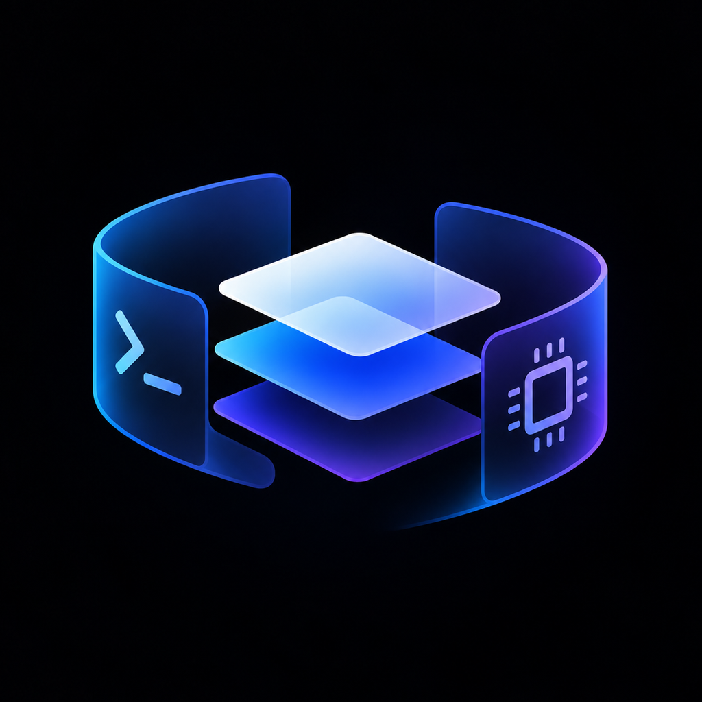
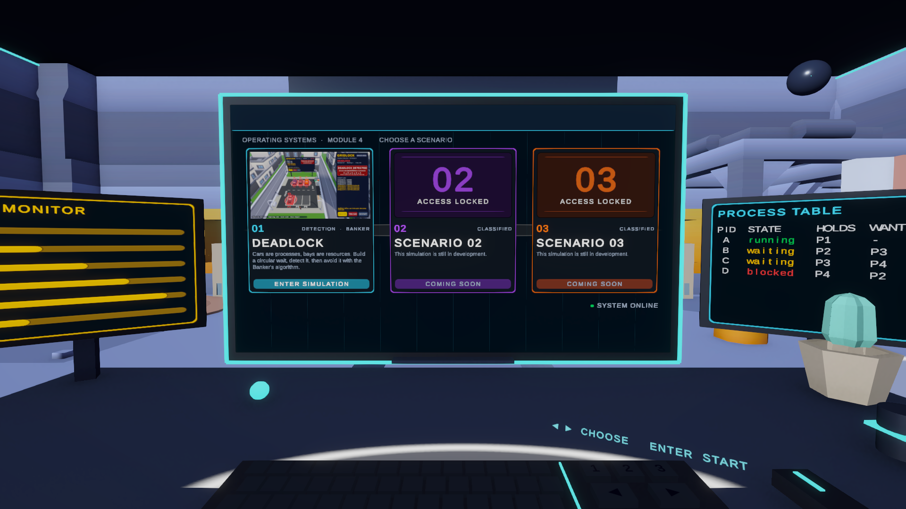
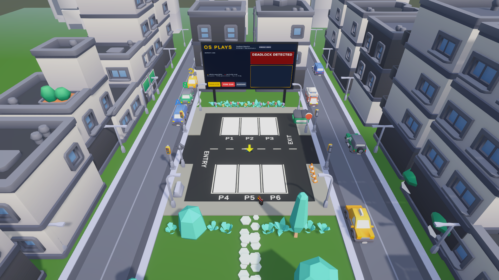
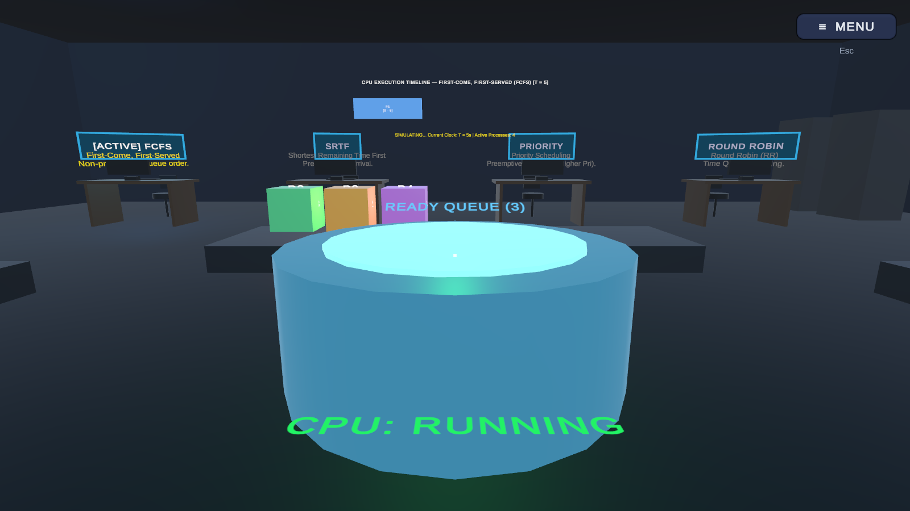
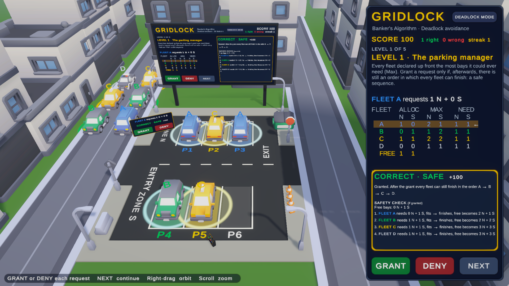

<p align="center"></p>

# OS Plays

Operating-systems concepts you can walk into. OS Plays is a Unity VR app for **Meta Quest 2** (and newer Quest
headsets) where each OS topic is a playable scenario, started from a sci-fi control room. The same app also runs on a
**desktop** (Linux/Windows, mouse and keyboard) and on **Android phones** (augmented reality: every scene as a model on your table).

| # | Scenario | What you do |
|---|---|---|
| 01 | **Deadlock** | Cars are processes, parking bays are resources. Watch a circular wait form, detect it, break it. |
| 01b | **Banker's Algorithm** | Be the parking manager: grant or deny requests so every fleet can still finish (safe state). |
| 02 | **CPU Scheduling** | A lab where processes queue for one CPU core: FCFS, SRTF, Priority, Round Robin, a Gantt board and a quiz. |
| 03 | **Memory Management** | A warehouse where pallets are frames and boxes are pages: FIFO, LRU and Optimal page replacement. |

<p align="center">
  
  
  
  
</p>

**Contents:** [Install and play](#install-and-play) · [Controls](#controls) · [Menu and settings](#menu-and-settings) ·
[Troubleshooting](#troubleshooting) · [For developers](#for-developers)

---

## Install and play

There are two app files (APKs), built from this project (see [Building](#building)):

| File | For | Android package |
|---|---|---|
| `Builds/OSPlays-Quest.apk` | Meta Quest 2, 3, 3S, Pro | `com.anasarfeen.gridlock` |
| `Builds/OSPlays-Phone.apk` | Android phones (Android 10 or newer) | `com.anasarfeen.gridlock.mobile` |

Both are installed with **adb** (Android Debug Bridge). If you have the Unity Android module, adb is already at
`<Unity>/Editor/Data/PlaybackEngines/AndroidPlayer/SDK/platform-tools/adb`. Otherwise install Android
platform-tools (`sudo dnf install android-tools`, `sudo apt install adb`, or the Google download on Windows/macOS).

### Meta Quest

1. **Turn on developer mode (one time).**
   - If you have never done so, create a free developer organisation at <https://developer.oculus.com/manage/organizations/>
     (same Meta account as the headset).
   - In the **Meta Horizon** app on your phone: **Devices ▸ your headset ▸ Headset settings ▸ Developer mode ▸ On**.
   - Restart the headset.
2. **Connect the headset** to the computer with a USB-C cable that carries data (not a charge-only cable). Put the
   headset on and accept **Allow USB debugging** (tick **Always allow from this computer**).
3. **Check the connection.** `adb devices` should list the headset as `device`. `unauthorized` means the prompt
   in the headset was not accepted yet.
4. **Install** (`-r` replaces an older version and keeps your settings):
   ```bash
   adb install -r Builds/OSPlays-Quest.apk
   ```
5. **Start it** in the headset: **Library ▸ the filter at the top ▸ Unknown Sources ▸ OS Plays**.

You can unplug the cable once it is installed. Play in a cleared space with the Guardian boundary set up. Standing is
best, but the control room can be played seated.

**Hand tracking:** to play without controllers, turn on **Settings ▸ Movement tracking ▸ Hand and body tracking**
(wording differs between headset versions). Put the controllers down and the hands take over automatically.

### Android phone

1. **Turn on USB debugging (one time):** **Settings ▸ About phone**, tap **Build number** seven times, then
   **Settings ▸ System ▸ Developer options ▸ USB debugging ▸ On**.
2. **Connect** the phone by USB and accept **Allow USB debugging?** on the phone.
3. **Install:**
   ```bash
   adb install -r Builds/OSPlays-Phone.apk
   ```
4. Open **OS Plays** from the app drawer.

**Without a computer:** copy `OSPlays-Phone.apk` to the phone (Drive, e-mail, USB), tap it, and allow
**Install unknown apps** for the app you opened it from.

**AR:** every scene opens in augmented reality on phones with
[Google Play Services for AR](https://play.google.com/store/apps/details?id=com.google.ar.core) (ARCore). Point the
camera at a floor or table, wait for the grid, and tap to place the model. Scenarios you enter from the control room
appear on the same spot. Phones without ARCore play the same scenes on the touch screen.

### Desktop

Open the project in Unity (see [For developers](#for-developers)), open `Assets/Scenes/GridlockHub.unity` and press
**Play**. Without a headset connected you get the desktop view. A standalone desktop build can be made with
**File ▸ Build Profiles** (Linux or Windows), with `GridlockHub` as the first scene.

### Uninstall

```bash
adb uninstall com.anasarfeen.gridlock          # Quest
adb uninstall com.anasarfeen.gridlock.mobile   # phone
```

Or on the Quest: **Library ▸ Unknown Sources ▸ ⋯ next to OS Plays ▸ Uninstall**.

---

## Controls

Every scene has a **guided tour** the first time you visit (replay it from the menu) and a **HOW TO PLAY** page in the
menu with that scene's details.

### Meta Quest: controllers

| Control | Action |
|---|---|
| **Trigger** (point first) | Select / press: cars, bays, buttons, keys, screens |
| **Grip** | Grab (the Memory boxes) |
| **Left stick** | Walk (or teleport only: menu ▸ SETTINGS ▸ CONTROLS ▸ VR MOVING) |
| **Right stick ◄ ►** | Turn: snap (one turn per flick) or smooth, see VR TURNING |
| **Right stick ▲**, release | Teleport to the marked spot |
| **Right stick ▼** | Turn around |
| **Y** or **≡** (left) | Open / close the menu |
| **A / B / X** | Scene shortcuts (below) |
| Look at a controller | A card shows that controller's buttons |
| Turn the left palm towards your face | Wrist menu (MENU, plus SIT AT DESK in the control room) |

| Scene | A | B | X |
|---|---|---|---|
| Deadlock | Analyze (show who waits for whom) | Tow the selected car | Hold: restart |
| Banker's Algorithm | Grant | Deny | Next |
| CPU Scheduling | Run / pause | Step | Simulator window |
| Control room, Memory | – | – | – |

### Meta Quest: hand tracking

| Gesture | Action |
|---|---|
| Point, then **pinch** (thumb and index) | Select / press what the ray points at |
| Poke a button with your index finger | Press it (menus, keyboard, screens within reach) |
| Pinch a box, hold, move, release | Grab and carry (Memory) |
| Point at the floor, pinch, release | Teleport there |
| Pinch in empty space, flick the hand left / right | Turn |
| Turn the left palm towards your face | Wrist menu with **MENU** |
| Look at the left palm and pinch (Quest system gesture) | Open / close the menu |

### Desktop (mouse and keyboard)

| Where | Controls |
|---|---|
| Control room | Click the desk keys, or **◄ ►** / **1 2 3** and **Enter** to start a scenario. **R** stands up: **WASD** walk, **Shift** run, right-drag look, click the floor to walk there. **R** or click the chair to sit. |
| Deadlock, Banker's | Click a car, then a bay. Right-drag orbit, scroll zoom, hover to inspect. Buttons on the right panel. |
| CPU Scheduling, Memory | **WASD** walk, mouse look, **E** or click to use what the dot points at. CPU: **U** simulator window. Memory: click a box to pick it up, then a pallet to put it there. |
| Everywhere | **Esc** or the **≡ MENU** button opens the menu (and frees the mouse). |

### Phone (AR)

Everywhere: **pinch** to resize the model, **twist** two fingers to rotate it, **drag** one finger to slide it, **MOVE**
to place it somewhere else. Walk around the table to look from another side; the walls facing you open up.

| Where | Controls |
|---|---|
| Control room | Tap a scenario card on the big holo screen, then tap it again to enter (or use the keypad). |
| Deadlock, Banker's | Tap a car, then a bay. |
| CPU Scheduling | Tap a desk to pick an algorithm, the console or the **RUN / STEP / SIMULATOR** buttons to run it. |
| Memory | Tap a page box (it floats up), then the pallet of a frame. |
| Everywhere | **≡ MENU** or the Android back gesture opens the menu. |

Without ARCore the phone uses the touch view: tap the keypad in the control room; tap a car, then a bay, drag to orbit,
pinch to zoom in the lots; an on-screen stick to walk, drag to look and tap to use in the CPU and Memory scenes.

### Memory Management in VR

Grab a box (grip, close by or with the ray) and let go of it on a frame's pallet on the rack, or just in front of the
rack below that pallet, so you don't have to reach above your head. A correct move loads the page. A wrong frame tells
you why and sends the box back to its table, and so does a box dropped on the floor. Pages in memory stay on their
pallet until the algorithm evicts them.

---

## Menu and settings

Open with **Y / ≡** (Quest), the wrist menu, **Esc** (desktop) or **≡ MENU** (phone). The game pauses while it is
open. In the headset the menu floats within arm's reach: point and pull the trigger, or poke it.

**RESUME** · **GUIDED TOUR** (replay) · **RESTART** · **BANKER MODE / DEADLOCK MODE** (lot scenes) ·
**◄ CONTROL ROOM** · **SETTINGS** · **HOW TO PLAY** · **QUIT**

Settings are saved on the device and apply immediately. **RESET ALL** restores the defaults.

| Tab | Setting | Options (default **bold**) | Notes |
|---|---|---|---|
| Audio | MASTER, MUSIC, EFFECTS, NARRATOR | sliders (100 %, 60 %, 85 %, 100 %) | |
| Display | GRAPHICS | PERFORMANCE · **BALANCED** · QUALITY | Headset resolution, edge smoothing, detail distance |
| | POST EFFECTS | **ON** · OFF | Glow and colour grading. Always off on Quest (frame rate) |
| | SHADOWS | **ON** · OFF | |
| | SUBTITLES | **ON** · OFF | Captions for the narrator |
| Controls | LOOK SPEED | slider (**1.0×**) | Mouse, touch and orbit |
| | INVERT LOOK | **OFF** · ON | |
| | VR TURNING | **SNAP** · SMOOTH | Snap: a quick sweep per flick. Smooth: eases in and out |
| | SNAP ANGLE | 30° · **45°** · 90° | Also used by the hand flick |
| | VR MOVING | TELEPORT · **WALK** | Left stick walks, or teleport only |
| Gameplay | GUIDED TOURS | **AUTO** · OFF | Play each tour on the first visit |
| | CAR SPEED | SLOW · **NORMAL** · FAST | Deadlock and Banker's scenes |
| | REPLAY TOURS | SHOW TOURS AGAIN | |

---

## Troubleshooting

| Problem | Fix |
|---|---|
| `adb devices` shows nothing | Use a data USB cable, try another port, and on the Quest check that developer mode is on (restart after enabling). On Linux, adb may need udev rules for the device. |
| `adb devices` shows `unauthorized` | Put the headset on (or unlock the phone) and accept **Allow USB debugging**. If no prompt shows, run `adb kill-server` and reconnect. |
| `INSTALL_FAILED_UPDATE_INCOMPATIBLE` | An older build signed with another key is installed: uninstall it first (see [Uninstall](#uninstall)). |
| `INSTALL_FAILED_INSUFFICIENT_STORAGE` | Free some space on the device (the APK is about 60 MB). |
| Can't find the app on the Quest | **Library ▸ filter ▸ Unknown Sources**. It is not listed under "All". |
| Hands don't appear | Turn on hand tracking in the Quest settings and put the controllers down. |
| The menu won't open in the headset | Press **Y** or the left **≡**, or with hands look at your left palm and pinch. |
| No AR on the phone | Install or update *Google Play Services for AR*. Without it the touch view is used. |
| Low frame rate on the Quest | Menu ▸ SETTINGS ▸ DISPLAY ▸ GRAPHICS ▸ PERFORMANCE. |
| See what the app logs | `adb logcat -s Unity` while it runs. |

---

## For developers

### What you need

- **Unity 6000.3.25f1** (Unity 6.3) from Unity Hub. Other Unity versions are not supported: the project embeds a
  patched package that is tied to this version.
- For Quest and phone builds: the **Android Build Support** module with **OpenJDK** and **Android SDK & NDK Tools**
  (tick them when adding the module in Unity Hub).
- Git, and Python 3 if you want to regenerate audio (`Tools/`).

### Open the project

```bash
git clone https://github.com/Anasarfeen123/os-plays.git
```

In Unity Hub: **Add ▸ Add project from disk**, pick the cloned folder, open it with 6000.3.25f1. The first import takes
a while (it builds the `Library/` cache, which is not in Git). Then open `Assets/Scenes/GridlockHub.unity` and press
**Play**.

**Testing VR without a headset:** in the scene's `XR Mode` object, tick **Simulate XR In Editor** to play with the XR
Interaction Simulator (keyboard and mouse drive the controllers and hands).

### How the project is put together

**The scenes are generated by code.** Everything in `Assets/Scenes/Gridlock*.unity` is built by
`Assets/Editor/GridlockSceneBuilder*.cs`. Do not edit those scenes by hand: the next rebuild replaces them. Change the
builder instead, then run **GRIDLOCK ▸ Build Scenes** (menu bar). The two imported scenarios start from their own
original scenes in `Assets/Scenarios/`, which the builder opens and turns into the OS Plays scene.

```
Assets/
  Scripts/            Runtime code (assembly Gridlock.Runtime): Core, Deadlock, Banker, Hub, Guide, UI, XR, AR
  Editor/             Scene generator (GridlockSceneBuilder.*.cs), Quest/phone build setup, tools
  Scenarios/
    CPUScheduling/    Imported scenario 02 (its own scripts, original scene)
    MemoryManagement/ Imported scenario 03 (its own scripts, original scene, the VR hands)
    Shared/           Glue between the imported scenarios and OS Plays (first-person player, VR bridge, text fit)
  Scenes/             Generated scenes (do not hand-edit)
  Tests/              EditMode and PlayMode tests
  Audio/, UI/, ThirdParty/, Samples/   Assets (Kenney kits, XR Interaction Toolkit samples, logo, music)
Packages/
  com.unity.xr.hands/ Embedded and patched XR Hands 1.9.0 (see its GRIDLOCK_PATCH.md)
Docs/                 GRIDLOCK_SPEC.md (the design spec, source of truth), CREDITS.md, screenshots
Tools/                Python helpers: audio and music synthesis, narration, scenario import
Builds/               APK output (not in Git)
```

Internally the code still uses the project's first name, **GRIDLOCK** (namespaces, menu, scene files). The app name
shown to players is **OS Plays**. Read `Docs/GRIDLOCK_SPEC.md` before larger changes: it records how each scenario,
the hub, the menus and the Quest setup are meant to work.

Useful places when changing VR behaviour:

| What | Where |
|---|---|
| XR rig, hands on the grip pose, pinch thresholds, ray stabilisation | `GridlockSceneBuilder.cs` (`BuildXRRig`, `BuildControllerHands`, `TunePinchAndRays`), `Scripts/XR/ControllerGripPose.cs` |
| Turning (snap sweep, smooth easing, hand flick) | `Scripts/XR/ComfortTurn.cs`, `Scripts/XR/HandTeleport.cs` |
| Menu, wrist menu | `Scripts/UI/SystemMenu.cs`, `Scripts/XR/WristMenu.cs`, `GridlockSceneBuilder.Menu.cs` |
| Settings | `Scripts/Core/GameSettings.cs` (values), `Scripts/Core/SettingsApplier.cs` (effects) |
| Quest performance | `Scripts/XR/QuestPerformance.cs`, `Scripts/XR/QuestFrameBudget.cs` |

### Building

| What | Menu | Output |
|---|---|---|
| All scenes | **GRIDLOCK ▸ Build Scenes** | `Assets/Scenes/*.unity` |
| Android phone (ARCore AR in the lot scenes) | **GRIDLOCK ▸ Build Phone APK** | `Builds/OSPlays-Phone.apk` |
| Meta Quest | **GRIDLOCK ▸ Build Quest APK** | `Builds/OSPlays-Quest.apk` |

Rebuild the scenes after changing a builder, then the APKs. **Build the phone APK before the Quest APK:** both rewrite
the shared Android XR loader settings (ARCore for the phone, OpenXR for the Quest), and the last build leaves them
set. Leaving the project on the Quest settings keeps Play-in-editor and the headset simulator working.

From a terminal (CI, or with the Unity editor closed; batchmode cannot open a project that is open in the editor):

```bash
UNITY=~/Unity/Hub/Editor/6000.3.25f1/Editor/Unity
$UNITY -batchmode -quit -projectPath . -executeMethod Gridlock.Editor.GridlockSceneBuilder.Build -logFile -
$UNITY -batchmode -quit -projectPath . -buildTarget Android -executeMethod Gridlock.Editor.GridlockPhoneSetup.ConfigureAndBuild -logFile -
$UNITY -batchmode -quit -projectPath . -buildTarget Android -executeMethod Gridlock.Editor.GridlockQuestSetup.ConfigureAndBuild -logFile -
```

Then install with `adb install -r Builds/OSPlays-Quest.apk` (see [Install and play](#install-and-play)).

**Jump straight into a scene on a device** (skips the control room):

```bash
adb shell setprop debug.gridlock.scene GridlockMemory   # or GridlockParkingLot, GridlockBanker, GridlockCPUScheduling
adb shell setprop debug.gridlock.scene ""               # back to normal
```

### Tests

**Window ▸ General ▸ Test Runner**, or from a terminal:

```bash
$UNITY -batchmode -projectPath . -runTests -testPlatform EditMode -testFilter Gridlock -testResults editmode.xml
$UNITY -batchmode -projectPath . -runTests -testPlatform PlayMode -testFilter Gridlock -testResults playmode.xml
```

EditMode covers the algorithms (deadlock detection, Banker's safety check). PlayMode loads every scene on desktop,
phone and in the headset simulator. It checks that every grabbable or pressable thing is reachable with the VR hands,
that the Memory boxes can be grabbed and dropped on frames, that every menu setting applies, and how turning and pinch
behave. Please keep them green.

PlayMode tests play the game's music and narration. To run them silently on Linux (PipeWire/PulseAudio), send Unity's
audio to a null sink:

```bash
pactl load-module module-null-sink sink_name=silent
PULSE_SINK=silent $UNITY -batchmode -projectPath . -runTests -testPlatform PlayMode -testFilter Gridlock -testResults playmode.xml
```

If the sound still reaches your speakers, move the stream yourself. Find it with `pactl list short sink-inputs`, then
run `pactl move-sink-input <id> silent`. Remove the sink afterwards with `pactl unload-module module-null-sink`.

### Releasing

One command builds both APKs, commits the version, tags it, pushes, and publishes a GitHub Release with the APKs:

```bash
Tools/release.sh 0.2.0            # needs the Unity editor closed and gh logged in
Tools/release.sh 0.2.0 --dry-run  # build only, into Builds/release/
```

The version code grows with each release (0.2.0 → 200), so installed copies update in place.

### Working together

See [CONTRIBUTING.md](CONTRIBUTING.md) for the branch and pull-request workflow, scene-merge rules and code style.

## Credits

Third-party assets (Kenney kits, XR Interaction Toolkit samples, the VR hand models, fonts) and their licenses are
listed in [Docs/CREDITS.md](Docs/CREDITS.md).

## License

OS Plays' own code and assets are released under the [MIT License](LICENSE). Third-party assets keep their own
licenses (see [Docs/CREDITS.md](Docs/CREDITS.md)).
